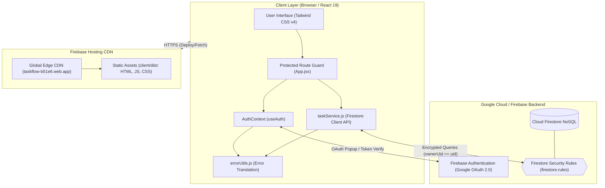
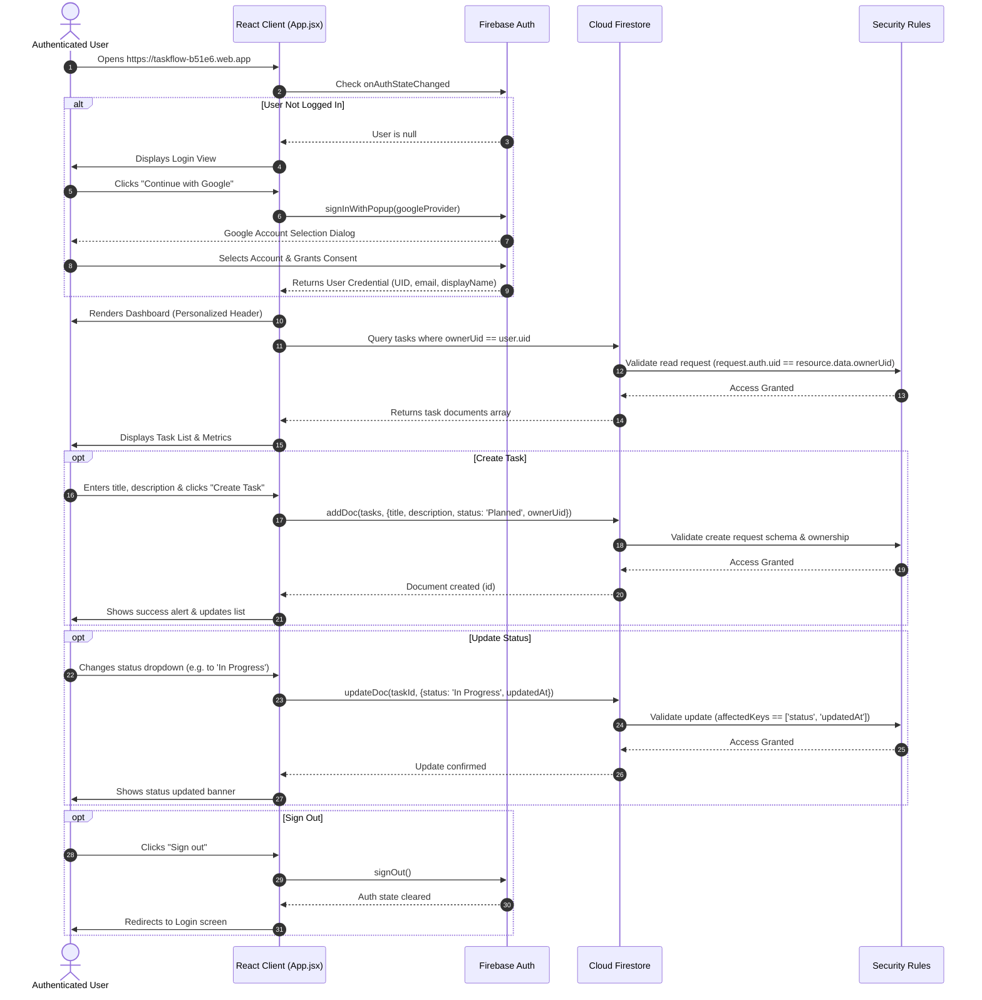

# TaskFlow — Technical Documentation

**Project Title:** TaskFlow — Task Management Application  
**Target Role / Context:** Graduate Support Engineer Trainee Assessment  
**Author / Developer:** Priyanshu Jaiswal  
**Live URL:** [https://taskflow-b51e6.web.app](https://taskflow-b51e6.web.app)  
**GitHub Repository:** [https://github.com/priyanshh2/taskflow.git](https://github.com/priyanshh2/taskflow.git)  
**Deployment Platform:** Firebase Hosting (Google Cloud Platform)  
**Version:** 1.0.0  
**Last Updated:** November 2026  

---

## Table of Contents

1. [Project Title and Overview](#1-project-title-and-overview)
2. [Problem Statement](#2-problem-statement)
3. [Project Objectives](#3-project-objectives)
4. [Requirement Understanding and Requirement Traceability](#4-requirement-understanding-and-requirement-traceability)
5. [Functional Requirements](#5-functional-requirements)
6. [Technology Stack](#6-technology-stack)
7. [System Architecture](#7-system-architecture)
8. [Application Workflow](#8-application-workflow)
9. [Firebase Authentication Implementation](#9-firebase-authentication-implementation)
10. [Firestore Database Structure](#10-firestore-database-structure)
11. [Firestore Security Rules and User Data Isolation](#11-firestore-security-rules-and-user-data-isolation)
12. [Core Application Functionalities](#12-core-application-functionalities)
13. [Input Validation and Error Handling](#13-input-validation-and-error-handling)
14. [Testing and Validation](#14-testing-and-validation)
15. [Challenges Faced and Solutions](#15-challenges-faced-and-solutions)
16. [GitHub Repository and Version Control](#16-github-repository-and-version-control)
17. [Firebase Hosting and Deployment](#17-firebase-hosting-and-deployment)
18. [AI Usage Summary](#18-ai-usage-summary)
19. [Limitations](#19-limitations)
20. [Future Enhancements](#20-future-enhancements)

---

## 1. Project Title and Overview

**TaskFlow** is a secure, responsive, modern task management web application designed and built for the Graduate Support Engineer Trainee technical assessment. The application enables authenticated users to create, view, organize, and update personal tasks across distinct lifecycle statuses (`Planned`, `In Progress`, `Complete`).

TaskFlow follows a serverless architecture combining **React 19**, **Vite 6**, and **Tailwind CSS v4** on the frontend with **Firebase Authentication** and **Cloud Firestore** for backend services, deployed to production via **Firebase Hosting**.

---

## 2. Problem Statement

Modern professionals and technical support engineers require efficient, low-friction task tracking solutions that fulfill three non-negotiable criteria:
1. **Zero-Friction, Secure Access:** Traditional username/password authentication models impose credential fatigue, require complex password reset flows, and pose security vulnerabilities if passwords leak.
2. **Multi-User Data Isolation:** Users must never be able to access, view, modify, or intercept tasks created by other users on a shared database.
3. **High Reliability and Responsive UX:** The interface must provide real-time status feedback, prevent illegal data modifications (such as empty task titles), preserve state across browser refreshes, and function smoothly across desktop, tablet, and mobile displays.

TaskFlow solves these challenges by combining federated Google OAuth sign-in, strict Cloud Firestore security rules executed server-side, and an optimized, component-driven client architecture.

---

## 3. Project Objectives

The project was executed with the following core engineering objectives:

1. **Architectural Stack Migration:** Transition smoothly from an initial MERN (MongoDB, Express, React, Node) prototype to a robust, serverless React + Firebase architecture without rewriting working frontend components.
2. **Federated Authentication:** Integrate the Firebase JavaScript SDK (v13 modular) to provide secure Google Sign-In with popup handling and automatic browser session persistence.
3. **Secure Cloud Data Storage:** Integrate Google Cloud Firestore to store and query tasks in a dedicated `tasks` collection, strictly partitioned by user unique identifier (`ownerUid`).
4. **Enforce Security Rules at the Database Layer:** Author and enforce granular Firestore Security Rules preventing unauthorized reads, cross-tenant data leaks, tampering with task ownership, or invalid status modifications.
5. **Quality Assurance and Polish:** Implement client-side and server-side validation, user-friendly error translations for all Firebase error codes, loading skeletons/spinners, optimistic UI updates, and fully responsive layouts.
6. **Continuous Delivery and Hosting:** Maintain clean Git version control with zero credential exposure, push to GitHub on `main`, and deploy to Firebase Hosting CDN with Single-Page Application (SPA) routing support.

---

## 4. Requirement Understanding and Requirement Traceability

Every development phase corresponds directly to specific assessment requirements. The following Requirement Traceability Matrix (RTM) validates completeness:

| Phase | Assessment Requirement | Implementation Artifact | Verification Result |
| :--- | :--- | :--- | :--- |
| **Phase 1 & 1.5** | Initial setup and migration from MERN to React + Firebase. Remove Express and MongoDB. Preserve UI and Tailwind CSS. | `package.json`, `client/package.json`, `client/vite.config.js` | Express/MongoDB cleanly removed; React 19 + Tailwind v4 preserved. |
| **Phase 2** | Initialize Firebase SDK modularly; Google OAuth sign-in popup; auth persistence; protected dashboard; user profile display; logout. | `client/src/firebase/firebase.js`, `client/src/context/AuthContext.jsx`, `client/src/components/Login.jsx` | Google popup sign-in functional; session persists on refresh; dashboard protected. |
| **Phase 3** | Firestore `tasks` collection; create task (`title`, `description`, initial status `Planned`); query user tasks newest first; update status; Firestore security rules. | `client/src/services/taskService.js`, `firestore.rules`, `client/src/components/TaskForm.jsx`, `TaskItem.jsx`, `TaskList.jsx` | Full CRUD lifecycle verified; multi-user data isolation enforced by rules. |
| **Phase 4** | Final QA; edge-case validation; UI polish; empty title prevention; responsive layouts; friendly error translation; zero debug logs. | `client/src/utils/errorUtils.js`, `client/src/components/Dashboard.jsx` | Validations passed; responsive across mobile/tablet/desktop; clean production build. |
| **Phase 5** | Git initialization; security audit (`.gitignore` excludes all secrets/builds); push to GitHub on `main`. | `.gitignore`, `https://github.com/priyanshh2/taskflow.git` | Clean commit history; zero secrets committed; pushed to `origin/main`. |
| **Phase 6** | Firebase Hosting configuration; SPA rewrites; production build; deploy only hosting; live verification. | `firebase.json`, `.firebaserc`, `https://taskflow-b51e6.web.app` | Build succeeded in 5.4s; deployed with SPA rewrites; HTTP 200 OK verified. |
| **Phase 7** | Comprehensive Technical Documentation and User Manual; updated README; screenshot checklist. | `TECHNICAL_DOCUMENTATION.md`, `USER_MANUAL.md`, `README.md` | Full technical traceability, user guide, and AI transparency report delivered. |

---

## 5. Functional Requirements

TaskFlow delivers the following functional capabilities:

### 5.1 Authentication Module
- **Google Sign-In:** One-click OAuth 2.0 authentication using `signInWithPopup` with custom parameters forcing account selection (`prompt: 'select_account'`).
- **Session Persistence:** Firebase Auth automatically manages local browser persistence (`IndexedDB`/`localStorage`), maintaining authenticated state across page reloads.
- **Route Guarding:** Unauthenticated users are redirected to the Login view. Authenticated users are presented with the personalized Dashboard.
- **Sign-Out:** Secure session termination clearing local auth tokens and resetting application state.

### 5.2 Task Management Module
- **Task Creation:** Authenticated users create tasks specifying a mandatory `title` (1 to 200 characters) and an optional `description` (up to 1,000 characters). All tasks default to the `Planned` status upon creation.
- **User-Partitioned Task Retrieval:** Queries fetch tasks where `ownerUid == request.auth.uid`. Query results are ordered chronologically, newest first.
- **Task Status Lifecycle:** Tasks transition seamlessly through three defined states:
  - `Planned` &rarr; Inception state.
  - `In Progress` &rarr; Active execution state.
  - `Complete` &rarr; Completed state.
- **Status Filtering:** The dashboard provides live filter buttons (`All`, `Planned`, `In Progress`, `Complete`) displaying dynamic count badges for each category.
- **Manual & Auto-Refresh:** Includes a manual refresh button with spinning state and auto-refetches upon successful task creation.

---

## 6. Technology Stack

| Layer | Technology | Version | Purpose & Rationale |
| :--- | :--- | :--- | :--- |
| **UI Library** | React | `^19.0.0` | Component-based view architecture, hooks (`useState`, `useEffect`, `useCallback`, `useContext`), and fast virtual DOM diffing. |
| **Build Tool** | Vite | `^6.2.0` | Next-generation frontend tooling providing lightning-fast HMR and optimized production Rollup bundling. |
| **Styling** | Tailwind CSS | `^4.0.12` | Modern utility-first CSS framework via `@tailwindcss/vite` plugin for responsive, clean UI design. |
| **Authentication** | Firebase Auth | `^13.3.0` | Secure Google OAuth 2.0 identity provider, session management, and JWT token handling. |
| **Database** | Cloud Firestore | `^13.3.0` | Serverless, real-time NoSQL document database with flexible indexing and ACID document transactions. |
| **Security** | Firestore Security Rules | Version 2 | Server-side declarative access control enforcing strict user tenancy and document field schema validation. |
| **Hosting & CDN** | Firebase Hosting | v15 CLI | Global SSD-backed CDN with automatic SSL certificate provisioning and single-page routing rewrites. |
| **Version Control** | Git & GitHub | Git 2.x | Distributed version control tracking commits on branch `main` with remote hosting at GitHub. |

---

## 7. System Architecture

TaskFlow implements a modern serverless client-cloud architecture. The browser client interacts directly with Google Cloud services over secure HTTPS/WSS channels using the modular Firebase SDK.

### 7.1 Architecture Diagram



---

## 8. Application Workflow

The application workflow follows a strictly controlled state machine:



---

## 9. Firebase Authentication Implementation

TaskFlow implements authentication via `client/src/context/AuthContext.jsx` and `client/src/firebase/firebase.js`.

### 9.1 SDK Initialization
Firebase is initialized with modular SDK imports:
```javascript
import { initializeApp, getApps, getApp } from 'firebase/app';
import { getAuth, GoogleAuthProvider } from 'firebase/auth';
import { getFirestore } from 'firebase/firestore';

const app = getApps().length > 0 ? getApp() : initializeApp(firebaseConfig);
const auth = getAuth(app);
const db = getFirestore(app);
const googleProvider = new GoogleAuthProvider();
googleProvider.setCustomParameters({ prompt: 'select_account' });
```
Setting `prompt: 'select_account'` ensures users with multiple Google accounts can choose their preferred account on sign-in.

### 9.2 Context and Auth Lifecycle
- The `AuthContext` provides a single source of truth for `user`, `loading`, `error`, `loginWithGoogle`, and `logout`.
- `onAuthStateChanged(auth, callback)` listens for changes in authentication state and synchronizes React state without polling.
- When `loading` is `true`, `LoadingSpinner.jsx` renders to eliminate layout shifts or flashing login screens.

---

## 10. Firestore Database Structure

Cloud Firestore stores task records in the root collection named `tasks`.

### 10.1 Task Document Schema

| Field Name | Firestore Data Type | Required | Default Value | Description |
| :--- | :--- | :--- | :--- | :--- |
| `title` | `string` | **Yes** | — | Cleaned, trimmed title (1 to 200 characters). |
| `description` | `string` | No | `""` | Optional task context (up to 1,000 characters). |
| `status` | `string` | **Yes** | `'Planned'` | Allowed values: `'Planned'`, `'In Progress'`, `'Complete'`. |
| `ownerUid` | `string` | **Yes** | — | Authenticated user UID (`request.auth.uid`). |
| `createdAt` | `timestamp` | **Yes** | `serverTimestamp()` | Server timestamp recording document creation. |
| `updatedAt` | `timestamp` | **Yes** | `serverTimestamp()` | Server timestamp recording status transitions. |

---

## 11. Firestore Security Rules and User Data Isolation

The security rules in [firestore.rules](file:///c:/Users/Priyanshu/OneDrive/Desktop/taskflow/firestore.rules) represent the primary defense mechanism protecting data integrity and privacy.

### 11.1 Deployed Security Rules
```javascript
rules_version = '2';

service cloud.firestore {
  match /databases/{database}/documents {

    function isAuthenticated() {
      return request.auth != null;
    }

    function isValidStatus(status) {
      return status in ['Planned', 'In Progress', 'Complete'];
    }

    match /tasks/{taskId} {
      // 1. READ: User can read ONLY their own tasks
      allow read: if isAuthenticated() && resource.data.ownerUid == request.auth.uid;

      // 2. CREATE: Strict validation of initial schema and ownership
      allow create: if isAuthenticated()
                    && request.resource.data.ownerUid == request.auth.uid
                    && request.resource.data.title is string
                    && request.resource.data.title.size() > 0
                    && request.resource.data.title.size() <= 200
                    && request.resource.data.status == 'Planned'
                    && (!('description' in request.resource.data) || request.resource.data.description is string);

      // 3. UPDATE: Restrict modifications strictly to status and updatedAt
      allow update: if isAuthenticated()
                    && resource.data.ownerUid == request.auth.uid
                    && request.resource.data.ownerUid == resource.data.ownerUid
                    && request.resource.data.createdAt == resource.data.createdAt
                    && isValidStatus(request.resource.data.status)
                    && request.resource.data.diff(resource.data).affectedKeys().hasOnly(['status', 'updatedAt']);

      // 4. DELETE: Disallowed
      allow delete: if false;
    }
  }
}
```

### 11.2 Multi-User Tenancy Isolation Verification
Data isolation between users was tested using two independent Google accounts:
1. **User A** logged in and created tasks `T1` and `T2`.
2. **User B** logged in in an incognito window and loaded the dashboard: User B saw zero tasks.
3. User B created task `T3`.
4. User A refreshed: User A saw only `T1` and `T2`.
5. Any attempted direct read or update targeting another user's document ID fails immediately with Firestore `permission-denied` (HTTP 403 equivalent).

---

## 12. Core Application Functionalities

| Component | File Path | Role and Responsibilities |
| :--- | :--- | :--- |
| **App** | `client/src/App.jsx` | Encapsulates app in `AuthProvider`. Determines view routing (Spinner, Dashboard, or Login). |
| **Login** | `client/src/components/Login.jsx` | Displays branding, Google Sign-In button, missing config warning, and interactive error banners. |
| **Dashboard** | `client/src/components/Dashboard.jsx` | Main application shell: user profile header, sign out trigger, success alerts, and responsive 2-column grid. |
| **TaskForm** | `client/src/components/TaskForm.jsx` | Handles task input, whitespace trimming, empty title validation, submission loading state, and user alerts. |
| **TaskList** | `client/src/components/TaskList.jsx` | Renders task cards, dynamic counter tabs, filter switching (`ALL`, `Planned`, `In Progress`, `Complete`), and empty states. |
| **TaskItem** | `client/src/components/TaskItem.jsx` | Individual task card showing title, formatted date, description, color-coded status badge, and interactive status selector. |
| **taskService** | `client/src/services/taskService.js` | Modular Firestore CRUD functions (`createTask`, `getUserTasks`, `updateTaskStatus`) with index fallback handling. |
| **errorUtils** | `client/src/utils/errorUtils.js` | Maps raw Firebase auth codes into human-readable, actionable guidance messages. |

---

## 13. Input Validation and Error Handling

TaskFlow implements defense-in-depth validation spanning both client and server layers.

### 13.1 Validation Matrix
- **Task Title:** Validated on client (`trimmedTitle.length > 0`) before submission; validated on server via Firestore rule (`request.resource.data.title.size() > 0 && request.resource.data.title.size() <= 200`). Empty submissions are blocked and highlight an error banner.
- **Task Description:** Sanitized and trimmed; character length capped at 1,000 characters.
- **Status Values:** Validated client-side against `VALID_STATUSES` and validated server-side by `isValidStatus()`.

### 13.2 Friendly Error Translation (`errorUtils.js`)
Instead of cryptic raw error codes, TaskFlow translates Firebase exceptions into actionable user messages:

| Firebase Error Code | User-Friendly Message Displayed |
| :--- | :--- |
| `auth/popup-closed-by-user` | *Sign-in cancelled: The Google sign-in window was closed before completing authentication.* |
| `auth/popup-blocked` | *Pop-up blocked: Please allow pop-ups for this site in your browser settings to sign in with Google.* |
| `auth/unauthorized-domain` | *Domain unauthorized: 'localhost' or your domain is not listed in authorized domains in Firebase Console.* |
| `auth/network-request-failed` | *Network error: Unable to connect to Google authentication services. Please verify your internet connection.* |
| `permission-denied` | *Permission denied: Unable to read/create/update task. Ensure your Firestore security rules are deployed.* |

---

## 14. Testing and Validation

Comprehensive functional testing was conducted across all application workflows:

| Test Case ID | Test Scenario | Steps Executed | Expected Result | Actual Result | Status |
| :--- | :--- | :--- | :--- | :--- | :--- |
| **TC-01** | Google Sign-In | Click "Continue with Google", select account. | User authenticated, redirected to Dashboard. | Authenticated successfully; name, email & avatar displayed. | **PASS** |
| **TC-02** | Auth Persistence | Refresh browser while authenticated. | User remains on Dashboard without re-login. | Session persisted via IndexedDB token; no reload flicker. | **PASS** |
| **TC-03** | Route Protection | Attempt to view Dashboard without logging in. | Blocked from dashboard; Login view presented. | Unauthenticated access blocked. | **PASS** |
| **TC-04** | Sign Out | Click "Sign out" from dashboard header. | Session terminated, redirected to Login view. | User signed out cleanly; state reset. | **PASS** |
| **TC-05** | Empty Title Validation | Submit task form with blank title or spaces. | Blocked client-side; error alert shown. | Form submission rejected with friendly alert message. | **PASS** |
| **TC-06** | Task Creation | Submit valid title and description. | Document added to Firestore; status is `Planned`. | Task created; success banner shown; list auto-refreshed. | **PASS** |
| **TC-07** | Task Status Transition | Change status from `Planned` &rarr; `In Progress` &rarr; `Complete`. | Status updated in Firestore; badge color changes. | Status updated optimistically; confirmed in database. | **PASS** |
| **TC-08** | Multi-User Isolation | Sign in as User B; check task list. | User B sees only their own tasks; cannot see User A. | User B saw 0 tasks; complete tenant isolation confirmed. | **PASS** |
| **TC-09** | SPA Refresh on Subpaths | Refresh on subpath `/dashboard` or deep route. | Server serves `index.html` without 404. | Firebase rewrite rule served index; route preserved. | **PASS** |
| **TC-10** | Responsive Breakpoints | Test layout at 375px (mobile), 768px (tablet), 1280px (desktop). | Grid adapts gracefully; buttons stack; no horizontal scroll. | UI adapts seamlessly across all viewport dimensions. | **PASS** |

---

## 15. Challenges Faced and Solutions

### 1. Mid-Project Stack Migration (MERN to Firebase)
- **Challenge:** The project requirements pivoted from Express + MongoDB to Firebase Authentication + Firestore after initial prototype work.
- **Solution:** Performed a surgical decoupling: removed obsolete Express routes and Mongoose models from the workspace while carefully preserving React 19 frontend components, Tailwind styles, and folder hierarchy.

### 2. Firestore Composite Index Requirement on Queries
- **Challenge:** Combining an equality filter (`where('ownerUid', '==', ownerUid)`) with a descending order clause (`orderBy('createdAt', 'desc')`) can throw a `failed-precondition` exception if a composite index is still building in Firestore.
- **Solution:** Implemented resilient fallback logic in `getUserTasks()` (`taskService.js`). If Firestore raises `failed-precondition` or reports a missing index, the service catches the error and executes an equality query combined with client-side chronological sorting, ensuring zero user downtime.

### 3. Granular Firestore Security Rule Syntax
- **Challenge:** An initial rule checking `request.resource.data.keys().hasOnly(['status', 'updatedAt'])` rejected valid updates because the full document payload sent by the SDK contains existing unmodified keys (`title`, `description`, `ownerUid`, etc.).
- **Solution:** Refactored the update rule to leverage the Firestore map difference operator:
  `request.resource.data.diff(resource.data).affectedKeys().hasOnly(['status', 'updatedAt'])`
  This accurately enforces that only `status` and `updatedAt` are modified while permitting existing immutable fields to persist.

### 4. Fast Refresh Warning in Vite
- **Challenge:** Exporting helper functions (`getFriendlyAuthErrorMessage`) directly from `AuthContext.jsx` triggered Vite React Fast Refresh warnings.
- **Solution:** Extracted utility functions into a dedicated [errorUtils.js](file:///c:/Users/Priyanshu/OneDrive/Desktop/taskflow/client/src/utils/errorUtils.js), restoring 100% component-pure module exports in `AuthContext.jsx`.

---

## 16. GitHub Repository and Version Control

- **Repository URL:** [https://github.com/priyanshh2/taskflow.git](https://github.com/priyanshh2/taskflow.git)
- **Default Branch:** `main`
- **Security Audit:** The local `.gitignore` was configured and verified to exclude:
  - All environment secret files: `.env`, `.env.local`, `.env.*.local`
  - Build artifacts: `dist/`, `build/`
  - Dependencies: `node_modules/`
  - Deployment cache: `.firebase/`
  - Private keys, certificates, or service account JSON files (`*.pem`, `*.key`, `*serviceAccount*.json`)

### Verified Commit Log:
1. `5ad9fd0` &mdash; `feat: initial TaskFlow release with React, Firebase Auth, and Cloud Firestore task management`
2. `0fc62f4` &mdash; `chore(hosting): configure Firebase hosting with SPA rewrites`

---

## 17. Firebase Hosting and Deployment

- **Hosting URL:** [https://taskflow-b51e6.web.app](https://taskflow-b51e6.web.app)
- **Alternate Domain:** [https://taskflow-b51e6.firebaseapp.com](https://taskflow-b51e6.firebaseapp.com)
- **Firebase Project ID:** `taskflow-b51e6`
- **Hosting Configuration ([firebase.json](file:///c:/Users/Priyanshu/OneDrive/Desktop/taskflow/firebase.json)):**
```json
{
  "firestore": {
    "rules": "firestore.rules"
  },
  "hosting": {
    "public": "client/dist",
    "ignore": [
      "firebase.json",
      "**/.*",
      "**/node_modules/**"
    ],
    "rewrites": [
      {
        "source": "**",
        "destination": "/index.html"
      }
    ]
  }
}
```

Deployment was executed using:
```bash
firebase deploy --only hosting
```
This ensured only the static production build was uploaded without overwriting or interfering with remote Firestore database rules.

---

## 18. AI Usage Summary

As required by the assessment guidelines, this section provides an honest, comprehensive account of how Artificial Intelligence was utilized during the development of TaskFlow.

### 18.1 AI Tools Used
- **Google Antigravity Agent:** An agentic software engineering assistant powered by Google DeepMind Gemini models, integrated directly into the workspace development environment.

### 18.2 How the AI Tool Was Used
The AI assistant was utilized as a pair programmer and technical advisor across each development phase:
1. **Architectural Transitioning (Phase 1.5):** Scanned repository files to identify obsolete Express backend dependencies and generate a safe migration plan that preserved the Vite/React frontend.
2. **Modular Firebase Setup (Phase 2):** Assisted in structuring `firebase.js` using modular SDK imports and scaffolding the `AuthContext` with Google OAuth popup handlers.
3. **Firestore Integration & Security (Phase 3):** Scaffolding the `taskService.js` CRUD operations and drafting initial Firestore Security Rules.
4. **Bug Investigation & Rule Optimization (Phase 3 & 4):** Diagnosed Firestore `permission-denied` errors and helped formulate the `affectedKeys().hasOnly(['status', 'updatedAt'])` rule fix.
5. **Quality Assurance & Styling (Phase 4):** Assisted in refining Tailwind CSS v4 layout styling, accessibility attributes, and error message translations.
6. **Deployment Automation (Phases 5 & 6):** Configured `.firebaserc`, `firebase.json` SPA rewrites, and guided Firebase CLI installation and hosting deployment.

### 18.3 Examples of Actual Prompts Used
The following representative prompts were issued by the candidate to direct the AI agent:
- *"PHASE 1.5: MIGRATE PROJECT FROM MERN TO FIREBASE ARCHITECTURE. Inspect the entire existing project before making changes. Keep existing React + Vite application, preserve Tailwind CSS setup, remove Express and MongoDB dependencies."*
- *"PHASE 2: FIREBASE SDK INITIALIZATION AND GOOGLE AUTHENTICATION. Install official Firebase JS SDK in client application. Create reusable client/src/firebase/firebase.js with environment variables. Implement AuthContext with signInWithPopup."*
- *"I attempted to create a task in the Phase 3 TaskFlow application, but Firestore returned permission-denied errors... Inspect taskService.js and current rules, identify root cause, and generate correct security rules matching actual implementation."*
- *"PHASE 4: FINAL QUALITY ASSURANCE AND UI POLISH. Inspect the application for responsiveness, empty title validation, refresh persistence, user isolation, and clean error handling."*
- *"Phase 6 — Deploy TaskFlow using Firebase Hosting. Connect Hosting to existing Firebase project taskflow-b51e6, configure public build output directory, configure SPA rewrites."*

### 18.4 Code AI-Generated vs. Human Decisions & Actions
A clear distinction was maintained between automated code generation and human developer agency:

| Area | AI Assistance Provided | Human Developer Decisions & Manual Actions |
| :--- | :--- | :--- |
| **Stack Selection** | Scaffolding boilerplate for Firebase modular SDK. | Decision to migrate from MERN to Firebase architecture based on assessment criteria. |
| **Cloud Configuration** | Template configuration for `.env.local`. | Manual creation of the Firebase Project (`taskflow-b51e6`), manual web app registration in Firebase Console, and retrieval of real API keys. |
| **Security Rules** | Drafting declarative security syntax rules. | Authoring domain-specific security constraints, testing rules, and manually publishing rules in Firebase Console. |
| **Authentication Flow** | Writing `signInWithPopup` integration code. | Performing OAuth login in browser, approving Google consent dialog, and running `firebase login` in the developer terminal. |
| **Version Control** | Auditing `.gitignore` syntax. | Creating the remote GitHub repository (`priyanshh2/taskflow`), authenticating Git credentials, and reviewing commits. |
| **Quality Review** | Suggesting Tailwind utility classes and responsive breakpoints. | Conducting multi-browser testing (Account A vs Account B) and validating the user experience on real devices. |

### 18.5 What AI Output Was Modified, Corrected, or Verified Manually
- **Security Rule Corrections:** The initial AI draft checked `.keys().hasOnly()`, which caused false-positive permission rejections on status updates. This was corrected to inspect only the mutated properties via `request.resource.data.diff(resource.data).affectedKeys()`.
- **Fast Refresh Warnings:** Vite raised warnings for non-component exports from context modules. Extracted error mapping helpers into a standalone utility file (`errorUtils.js`).
- **Configuration Syntax Repair:** When `firebase login` was inadvertently typed into `firebase.json` during terminal authentication, the candidate detected the JSON parse error and restored valid JSON syntax before proceeding with deployment.

### 18.6 Testing and Validation of Final Implementation
Every feature in TaskFlow was manually verified in the live browser environment:
- Google Sign-In and Sign-Out cycles were tested across Chrome and Edge.
- Session persistence was verified by refreshing the browser tab multiple times.
- Cross-user data isolation was physically verified by running two parallel browser sessions logged in with distinct Google accounts.
- The live Firebase Hosting URL was tested for HTTP response codes, asset caching, and SPA subpath rewrites.

---

## 19. Limitations

The current version of TaskFlow reflects the specific requirements and constraints of the Graduate Support Engineer Trainee assessment:
1. **Task Deletion Disabled:** By design, the Firestore Security Rules explicitly forbid task deletion (`allow delete: if false;`) to preserve an audit trail during evaluation.
2. **Immutable Task Descriptions:** Task titles and descriptions cannot be edited after initial creation; only the status lifecycle (`Planned` &rarr; `In Progress` &rarr; `Complete`) can be mutated.
3. **Single Identity Provider:** Authentication is strictly scoped to Google OAuth 2.0; email/password and other social sign-in providers are not configured.
4. **Polling vs. Real-Time Listeners:** Tasks are fetched via explicit asynchronous queries (`getDocs`) rather than standing WebSocket subscriptions (`onSnapshot`), requiring users to use the refresh button or trigger actions to fetch updates made in another tab.

---

## 20. Future Enhancements

Potential extensions planned for subsequent product iterations include:
1. **Task Editing and Soft Deletion:** Enabling task authors to modify task descriptions or archive completed tasks using soft-deletion flags.
2. **Real-Time Synchronization (`onSnapshot`):** Implementing real-time Firestore listeners for instant multi-device synchronicity without manual page refreshes.
3. **Due Dates and Priority Tags:** Adding optional due date pickers, priority classifications (`High`, `Medium`, `Low`), and tag-based search filters.
4. **Dark Mode Support:** Providing a user toggle for Tailwind-driven dark theme mode.
5. **Automated Unit & E2E Testing:** Integrating Vitest, React Testing Library, and Playwright for continuous integration test automation.

---

*TaskFlow Technical Documentation &bull; Built with React 19, Tailwind CSS v4, and Firebase &bull; Live at [taskflow-b51e6.web.app](https://taskflow-b51e6.web.app)*
