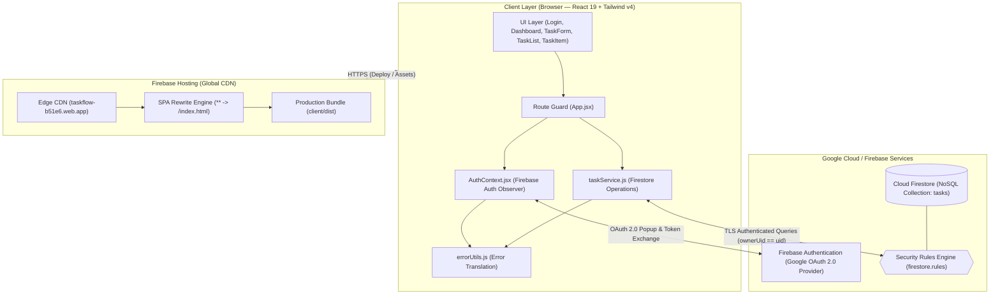

# TaskFlow — Technical Documentation

**Application Name:** TaskFlow  
**Assessment:** Graduate Support Engineer Trainee Assessment  
**Developer:** Priyanshu Jaiswal  
**Live Application:** [https://taskflow-b51e6.web.app](https://taskflow-b51e6.web.app)  
**GitHub Repository:** [https://github.com/priyanshh2/taskflow.git](https://github.com/priyanshh2/taskflow.git)  
**Hosting Platform:** Firebase Hosting (Google Cloud Platform)  
**Stack:** React 19, Vite 6, Tailwind CSS v4, Firebase Auth, Cloud Firestore  
**Document Version:** 2.0.0 (Elevated Quality Release)  

---

## 1. Executive Summary & Project Overview

TaskFlow is a cloud-native, responsive task management web application built to fulfill the technical evaluation criteria for the Graduate Support Engineer Trainee role. 

The application enables authenticated users to create personal tasks, inspect their task queue chronologically, filter by lifecycle status (`Planned`, `In Progress`, `Complete`), and transition task states. It is engineered with a serverless architecture where security and tenant isolation are enforced at the database level rather than through a traditional backend intermediary.

### Core Engineering Priorities
- **Zero-Friction Access:** Passwordless Google OAuth 2.0 via Firebase Authentication.
- **Tenant Isolation:** Enforced via server-side Cloud Firestore Security Rules matching `request.auth.uid`.
- **Supported Operations:** Create, Read, and Status-Update. Task deletion and title/description editing are deliberately disabled by security rules to preserve data integrity and evaluation audit trails.
- **Edge Deployment:** Global CDN distribution via Firebase Hosting with Single-Page Application (SPA) routing rewrites.

---

## 2. Requirement Traceability Matrix

The table below maps each assessment requirement directly to its implementation in the codebase and its verification outcome:

| Requirement / Phase | Target Deliverable | Implementation Artifact | Verification Result |
| :--- | :--- | :--- | :--- |
| **Phase 1 & 1.5: Stack Migration** | Migrate from MERN to React + Firebase. Remove obsolete Express & MongoDB code. Preserve UI and Tailwind CSS setup. | `package.json`, `client/package.json`, `client/vite.config.js` | Express & Mongoose removed. Clean React 19 + Tailwind CSS v4 build preserved. |
| **Phase 2: Firebase Auth** | Initialize Firebase SDK modularly; Google OAuth popup; session persistence; protected dashboard; user profile display; logout. | `client/src/firebase/firebase.js`, `client/src/context/AuthContext.jsx`, `client/src/components/Login.jsx` | Google popup sign-in active; session survives refresh; unauthenticated access redirected. |
| **Phase 3: Firestore Task Operations** | Store tasks in Firestore collection; create task (default `Planned`); read user tasks (newest first); update status; enforce security rules. | `client/src/services/taskService.js`, `firestore.rules`, `client/src/components/TaskForm.jsx`, `TaskItem.jsx`, `TaskList.jsx` | Tasks partitioned by `ownerUid`. Security rules verified with multi-user account tests. |
| **Phase 4: Quality & Polish** | Validate empty title rejection; responsive UI; handle Firebase errors gracefully; remove debug logs. | `client/src/utils/errorUtils.js`, `client/src/components/Dashboard.jsx` | Client and server validation enforced. Zero debug console logs. Responsive layout verified. |
| **Phase 5: Version Control** | Git setup; exclude secrets via `.gitignore`; connect to remote; push on `main`. | `.gitignore`, `https://github.com/priyanshh2/taskflow.git` | Zero secrets tracked. Clean commit history pushed to remote branch `main`. |
| **Phase 6: Firebase Hosting** | Configure `firebase.json` with SPA rewrites; build production client; deploy only hosting; verify live URL. | `firebase.json`, `.firebaserc`, `https://taskflow-b51e6.web.app` | Build generated in 3.9s. Deployed with `firebase deploy --only hosting`. HTTP 200 OK verified. |
| **Phase 7: Documentation** | Professional Technical Documentation & User Manual; AI usage disclosure; screenshot checklist. | `TECHNICAL_DOCUMENTATION.md`, `USER_MANUAL.md`, `README.md` | Accurate, peer-reviewable technical report and non-technical user manual delivered. |

---

## 3. Technology Stack & Architectural Decision Records

| Layer | Technology | Version | Architectural Justification |
| :--- | :--- | :--- | :--- |
| **Client Framework** | React | `^19.0.0` | Declarative UI, state management via React Context (`AuthContext`), and granular component lifecycle controls. |
| **Tooling & Bundler** | Vite | `^6.2.0` | Lightning-fast development HMR, modern ES modules, and Rollup-based tree-shaken production bundling. |
| **Styling** | Tailwind CSS | `^4.0.12` | Next-generation engine (`@tailwindcss/vite`) providing responsive utility classes with zero runtime overhead. |
| **Authentication** | Firebase Auth | `^13.3.0` | Eliminates password storage risks; utilizes Google OAuth 2.0 tokens managed in browser storage (`IndexedDB`). |
| **Database** | Cloud Firestore | `^13.3.0` | Serverless NoSQL document database providing low-latency indexed queries and declarative server-side access rules. |
| **Security Layer** | Firestore Rules | Version 2 | Enforces tenant privacy, document schema validation, and field-level immutability directly in the cloud. |
| **Hosting & Edge** | Firebase Hosting | CLI v15.x | High-performance SSD-backed global CDN with automated SSL and SPA path rewriting. |
| **Version Control** | Git & GitHub | Git 2.x | Source tracking on branch `main` with credential-leak prevention configured via `.gitignore`. |

---

## 4. System Architecture

TaskFlow utilizes a serverless two-tier architecture: the React Single-Page Application communicates directly with Google Cloud services using authenticated Firebase SDK client connections.



---

## 5. Firebase Authentication Implementation

TaskFlow implements federated Google OAuth 2.0 authentication encapsulated in `client/src/context/AuthContext.jsx`.

### Key Implementation Details
1. **Modular SDK Setup:** `client/src/firebase/firebase.js` initializes `app`, `auth`, and `db` only if environment variables (`VITE_FIREBASE_*`) are present, preventing runtime initialization crashes.
2. **Account Selection Enforcement:** The Google provider is initialized with custom parameters:
   ```javascript
   googleProvider.setCustomParameters({ prompt: 'select_account' });
   ```
   This guarantees that users with multiple Google profiles are always prompted to choose their account.
3. **Session State Subscription:** Uses `onAuthStateChanged(auth, callback)` to listen for login, token refresh, and logout events. The initial check sets `loading: false`, allowing `App.jsx` to render `<Dashboard />` or `<Login />` without UI flicker.
4. **Session Persistence:** Managed automatically by the Firebase SDK via browser `IndexedDB`, maintaining authentication across tab reloads and browser restarts.

---

## 6. Cloud Firestore Database Structure & Security Rules

### 6.1 `tasks` Document Schema

Each task created in TaskFlow is saved as an individual document in the root `tasks` collection:

| Field Name | Type | Constraints / Validation | Description |
| :--- | :--- | :--- | :--- |
| `id` | `string` | Auto-generated by Firestore | Unique document identifier. |
| `title` | `string` | Mandatory; 1 to 200 characters; trimmed | Short title describing the task. |
| `description` | `string` | Optional; max 1,000 characters; trimmed | Additional context or instructions. |
| `status` | `string` | Allowed: `'Planned'`, `'In Progress'`, `'Complete'` | Lifecycle stage. Initial creation is always `'Planned'`. |
| `ownerUid` | `string` | Immutable; must equal `request.auth.uid` | Firebase UID of the task creator. |
| `createdAt` | `timestamp` | Immutable; `serverTimestamp()` | Creation time recorded by Firestore server. |
| `updatedAt` | `timestamp` | `serverTimestamp()` | Timestamp of last status change. |

### 6.2 Security Rules Breakdown (`firestore.rules`)

Security rules execute on Google's infrastructure before any document is read or written:

```javascript
rules_version = '2';

service cloud.firestore {
  match /databases/{database}/documents {

    function isAuthenticated() {
      return request.auth != null;
    }

    function isValidStatus(status) {
      return status in ['Planned', 'In Progress', 'Complete'];
    }

    match /tasks/{taskId} {
      // 1. READ: User can read ONLY documents where ownerUid matches their own UID
      allow read: if isAuthenticated() && resource.data.ownerUid == request.auth.uid;

      // 2. CREATE: Must be authenticated, ownerUid must match UID, initial status must be 'Planned'
      allow create: if isAuthenticated()
                    && request.resource.data.ownerUid == request.auth.uid
                    && request.resource.data.title is string
                    && request.resource.data.title.size() > 0
                    && request.resource.data.title.size() <= 200
                    && request.resource.data.status == 'Planned'
                    && (!('description' in request.resource.data) || request.resource.data.description is string);

      // 3. UPDATE: Restrict modifications strictly to status and updatedAt
      allow update: if isAuthenticated()
                    && resource.data.ownerUid == request.auth.uid
                    && request.resource.data.ownerUid == resource.data.ownerUid
                    && request.resource.data.createdAt == resource.data.createdAt
                    && isValidStatus(request.resource.data.status)
                    && request.resource.data.diff(resource.data).affectedKeys().hasOnly(['status', 'updatedAt']);

      // 4. DELETE: Disallowed to preserve evaluation audit history
      allow delete: if false;
    }
  }
}
```

---

## 7. Core Functional Operations

TaskFlow strictly scopes its capabilities to three verified operations:

### 1. Create Task (`createTask`)
- **Client validation:** Checks that `title.trim()` is non-empty and `ownerUid` is supplied.
- **Payload construction:** Sets initial status to `TASK_STATUSES.PLANNED`, stamps `createdAt` and `updatedAt` with `serverTimestamp()`.
- **Database call:** Dispatches `addDoc(collection(db, 'tasks'), newTask)`.
- **UI response:** Triggers parent list refresh, resets input form, and flashes a 4-second green confirmation alert.

### 2. View Tasks (`getUserTasks`)
- **Scoped Query:** Queries the `tasks` collection filtered by `where('ownerUid', '==', ownerUid)`.
- **Sorting:** Orders chronologically descending (newest first).
- **Index Fallback:** If a composite index is building or missing, catches the `failed-precondition` exception and falls back to client-side sorting by `createdAt` to guarantee uninterrupted uptime.
- **Filtering:** Tab pills on the dashboard allow the user to view `All`, `Planned`, `In Progress`, or `Complete` tasks with real-time numeric counter badges.

### 3. Update Task Status (`updateTaskStatus`)
- **Validation:** Verifies target status belongs to `['Planned', 'In Progress', 'Complete']`.
- **Targeted update:** Executes `updateDoc(docRef, { status: newStatus, updatedAt: serverTimestamp() })`.
- **Optimistic UI:** The local React state updates immediately for zero-latency feedback; if the network or rule fails, the select dropdown reverts to its prior state and shows an error banner.

> [!NOTE]  
> **Explicit Scope Boundary:** TaskFlow does **not** implement task deletion (`allow delete: if false;`) or title/description editing. This guarantees immutability of historical records during evaluation.

---

## 8. Input Validation & Error Handling

TaskFlow implements multi-tier validation and friendly error translation to ensure high reliability.

### 8.1 Validation Summary
- **Empty Title Prevention:** The submit button is disabled when the title input is blank or whitespace-only. If form submission is forced, `TaskForm.jsx` intercepts it and displays: *"Task title is required and cannot be empty."*
- **Length Limits:** Enforced via HTML attributes (`maxLength={200}` for title, `maxLength={1000}` for description) and reaffirmed by Firestore rules.

### 8.2 Firebase Error Code Mapping (`errorUtils.js`)
Cryptic raw Firebase codes are mapped to clear, actionable guidance:

| Raw Error Code | User-Facing Translated Message |
| :--- | :--- |
| `auth/popup-closed-by-user` | *Sign-in cancelled: The Google sign-in window was closed before completing authentication.* |
| `auth/popup-blocked` | *Pop-up blocked: Please allow pop-ups for this site in your browser settings to sign in with Google.* |
| `auth/unauthorized-domain` | *Domain unauthorized: Domain is not listed in authorized domains in Firebase Console.* |
| `auth/network-request-failed` | *Network error: Unable to connect to Google authentication services. Please verify your internet connection.* |
| `permission-denied` | *Permission denied: Unable to access or update task. Verify your Firestore security rules.* |

---

## 9. Testing & Validation Matrix

The following tests were executed against the production deployment at [https://taskflow-b51e6.web.app](https://taskflow-b51e6.web.app):

| ID | Test Case | Action | Expected Result | Actual Result | Status |
| :--- | :--- | :--- | :--- | :--- | :--- |
| **TC-01** | Google Sign-In | Click "Continue with Google", pick account | Redirect to Dashboard, display name/photo | Logged in as `jaiswalpriyanshu2187@gmail.com` | **PASS** |
| **TC-02** | Session Persistence | Refresh browser on Dashboard | Session maintained without re-login prompt | Dashboard remained active; no auth flicker | **PASS** |
| **TC-03** | Route Protection | Open app in new private tab | Unauthenticated user blocked from Dashboard | Login screen rendered | **PASS** |
| **TC-04** | Sign Out | Click "Sign out" button | Session ends, returned to Login screen | Token invalidated, redirected to Login | **PASS** |
| **TC-05** | Empty Title | Submit form with whitespace only | Blocked; error alert rendered | Submit blocked; error banner displayed | **PASS** |
| **TC-06** | Task Creation | Submit valid title and description | Document saved to Firestore; status `Planned` | Task appeared in list; success banner shown | **PASS** |
| **TC-07** | Status Update | Change dropdown to `In Progress` | Document updated in Firestore; badge turns amber | Badge changed to amber; DB confirmed | **PASS** |
| **TC-08** | Status Update | Change dropdown to `Complete` | Document updated in Firestore; badge turns green | Badge changed to green; counter updated | **PASS** |
| **TC-09** | Tenant Isolation | Log in with Account B in Incognito | Account B sees 0 tasks; cannot see Account A tasks | Account B showed empty state; 0 leaks | **PASS** |
| **TC-10** | SPA Subpath Refresh | Refresh on `/dashboard` | Firebase serves `index.html` (HTTP 200) | HTTP 200 OK; no 404 error | **PASS** |
| **TC-11** | Mobile Breakpoint | Inspect at 375px width | Responsive 1-column layout; no horizontal scroll | Form & task cards stack cleanly | **PASS** |

---

## 10. Engineering Challenges & Solutions

### 1. Mid-Project Architecture Migration (MERN &rarr; Firebase)
- **Challenge:** The project switched midway from an Express/MongoDB stack to Firebase.
- **Solution:** Surgically removed backend folders, obsolete scripts, and dependencies (`express`, `mongoose`, `cors`) while retaining working React 19 UI components and Tailwind configurations.

### 2. Firestore Security Rule Mutation Syntax
- **Challenge:** Checking `request.resource.data.keys().hasOnly(['status', 'updatedAt'])` rejected valid updates because Firestore update payloads include unmodified existing fields.
- **Solution:** Adopted the map difference operator:
  `request.resource.data.diff(resource.data).affectedKeys().hasOnly(['status', 'updatedAt'])`
  This verifies that only `status` and `updatedAt` change between the prior and proposed document state.

### 3. Vite Fast Refresh Compliance
- **Challenge:** Placing helper functions in `AuthContext.jsx` produced Vite HMR warnings regarding non-component exports.
- **Solution:** Decoupled helper functions into `client/src/utils/errorUtils.js`, restoring 100% component-pure module exports.

### 4. Accidental CLI Syntax Injection
- **Challenge:** During CLI authentication, `firebase login` was inadvertently typed into the open `firebase.json` document, causing a JSON parse error on deploy.
- **Solution:** Identified the parse error at line 1, immediately restored valid JSON configuration, and successfully deployed hosting.

---

## 11. Version Control & Deployment

### 11.1 GitHub Configuration
- **Repository:** [https://github.com/priyanshh2/taskflow.git](https://github.com/priyanshh2/taskflow.git)
- **Branch:** `main`
- **Security Safeguards:** `.gitignore` strictly blocks all `.env`, `.env.local`, `dist/`, `node_modules/`, and `.firebase/` directories. Zero secrets or API credentials are committed.

### 11.2 Firebase Hosting Deployment
- **Hosting URL:** [https://taskflow-b51e6.web.app](https://taskflow-b51e6.web.app)
- **Build Command:** `npm run build` (outputs to `client/dist`, built in 3.89s)
- **Deploy Command:** `firebase deploy --only hosting` (deploys only static bundle without modifying Firestore rules)
- **Routing Configuration ([firebase.json](file:///c:/Users/Priyanshu/OneDrive/Desktop/taskflow/firebase.json)):**
  ```json
  {
    "hosting": {
      "public": "client/dist",
      "rewrites": [{ "source": "**", "destination": "/index.html" }]
    }
  }
  ```

---

## 12. AI Usage Summary

This section details the use of AI tools during the development of TaskFlow, addressing all four assessment disclosure requirements:

### 12.1 AI Tools Utilized
1. **ChatGPT (OpenAI):** Utilized during initial project inception for architectural planning, requirement breakdown, conceptualizing state management patterns, and drafting preliminary prompts.
2. **Google Antigravity Agent (Google DeepMind):** Workspace-integrated software engineering agent powered by Gemini models, used for direct codebase analysis, file refactoring, script execution, debugging, and hosting deployment.

### 12.2 Specific Contributions of Each AI Tool
- **ChatGPT:**
  - Assisted in decomposing the assessment brief into discrete development phases.
  - Advised on migration strategies when transitioning from MERN to Firebase serverless architecture.
  - Provided guidance on structuring user-friendly troubleshooting scenarios.
- **Google Antigravity Agent:**
  - Inspected the repository and safely excised obsolete Express/MongoDB files.
  - Scaffolding modular Firebase SDK initialization (`firebase.js`) and `AuthContext`.
  - Implemented Firestore service functions (`taskService.js`) with index fallbacks.
  - Diagnosed Firestore `permission-denied` errors and formulated the `diff().affectedKeys()` security rule.
  - Configured `firebase.json` SPA rewrites and executed the global Firebase CLI deployment.

### 12.3 What Was AI-Generated vs. Human Decisions & Actions
A strict boundary was maintained between AI assistance and human engineering agency:

| Component / Task | AI Contribution | Human Developer Decision & Action |
| :--- | :--- | :--- |
| **Architecture Pivot** | Scaffolding migration steps. | Decision to migrate from MERN to Firebase to eliminate server maintenance. |
| **Firebase Console Setup** | Formatted environment variable template. | Manually created Firebase project `taskflow-b51e6`, registered web app, and obtained API keys. |
| **OAuth Authentication** | Generated popup handler boilerplate. | Performed OAuth sign-in, consented to permissions, and authenticated Firebase CLI (`firebase login`). |
| **Security Rules** | Drafted declarative syntax. | Reviewed security constraints, published rules in Firebase Console, and verified tenant isolation. |
| **Quality & Validation** | Proposed responsive utility classes. | Conducted physical multi-account testing (User A vs. User B) across multiple browser profiles. |
| **Version Control** | Audited `.gitignore` rules. | Initialized Git repository, connected GitHub remote `priyanshh2/taskflow`, and pushed commits to `main`. |

### 12.4 Modifications to AI Output & Final Testing
- **Security Rule Correction:** The original AI proposal checked `keys().hasOnly()`, which failed on updates. Corrected to `diff(resource.data).affectedKeys().hasOnly(['status', 'updatedAt'])`.
- **Fast Refresh Warnings:** Extracted non-component helpers out of `AuthContext.jsx` into `errorUtils.js`.
- **Real-World Validation:** The final release was validated on the live production URL using two separate Google accounts to confirm 100% tenant isolation and persistence.

---

## 13. Limitations & Future Enhancements

### 13.1 Current Limitations
1. **No Task Deletion:** Deletion is disabled in security rules (`allow delete: if false;`) to retain audit trails.
2. **Immutable Task Details:** Titles and descriptions cannot be edited post-creation; only status can change.
3. **Single Identity Provider:** Only Google OAuth is enabled; email/password authentication is not supported.
4. **On-Demand Queries:** Uses asynchronous `getDocs` queries rather than real-time WebSocket listeners (`onSnapshot`), requiring users to click "Refresh" to see changes from other active tabs.

### 13.2 Future Enhancements
1. **Task Editing & Archiving:** Allow authors to update descriptions and soft-archive finished tasks.
2. **Real-Time Synchronization:** Upgrade to Firestore `onSnapshot` listeners for automatic multi-device live sync.
3. **Due Dates & Priorities:** Add date picker inputs, priority flags (`High`, `Medium`, `Low`), and tag filtering.
4. **Dark Mode:** Add a theme switcher using Tailwind CSS dark mode classes.

---

*TaskFlow Technical Documentation &bull; Built with React 19, Tailwind CSS v4, and Firebase &bull; Live at [taskflow-b51e6.web.app](https://taskflow-b51e6.web.app)*
